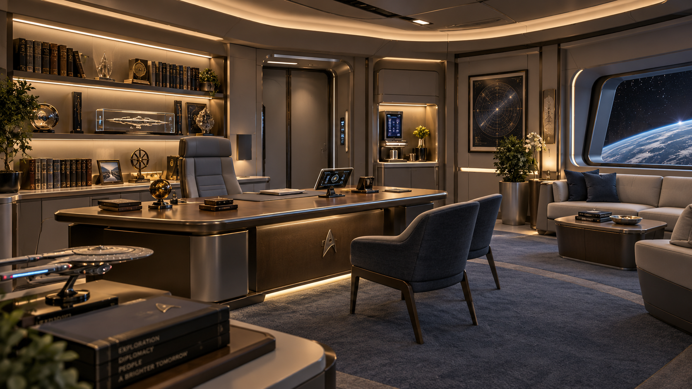

# USS Enterprise Valhalla — Despacho del capitán

**Ficha de identidad visual · DESPACHO DEL CAPITÁN / READY ROOM**  
**Estado:** APROBADO — estilo visual definitivo  
**Espacio:** Despacho del capitán, conectado lateralmente al puente principal  
**Función:** trabajo privado del capitán, conversaciones reservadas, reflexión, comunicaciones, representación personal y mando íntimo

---

## 1. Imagen de referencia aprobada

**Archivo:** `Valhalla_Despacho_del_Capitan_A1_Referencia.png`  
Esta imagen es la referencia estética oficial del **despacho del capitán** de la Valhalla. Define la atmósfera, materiales, iluminación y carácter del espacio. La geometría final podrá adaptarse al modelo 3D real, manteniendo esta identidad visual.

---

## 2. Intención visual del espacio

El despacho del capitán debe sentirse como un lugar **más íntimo y personal** que la sala de reuniones, pero claramente integrado en la misma nave. No es un camarote ni una oficina burocrática: es un espacio de mando privado, sereno y distinguido.

### Sensación buscada
- **Cálido-templado**
- **Íntimo y elegante**
- **Personal, pero sobrio**
- **Reflexivo y representativo**
- **Cómodo sin perder autoridad**

### Regla de identidad
Si el **puente principal** comunica _mando técnico_, y la **sala de reuniones** comunica _deliberación oficial_, el **despacho del capitán** debe comunicar _mando íntimo, criterio personal y autoridad tranquila_.

---

## 3. Diferencia respecto a otros espacios

### Puente principal
- más frío;
- más tecnológico;
- más operacional;
- menos personal.

### Sala de reuniones
- más formal y colectiva;
- pensada para oficiales y briefing;
- menos íntima.

### Despacho del capitán
- más personal;
- más cálido;
- más recogido;
- apto para trabajo, conversación privada y representación individual del capitán.

---

## 4. Paleta cromática aprobada

La base visual del despacho combina la familia cromática Valhalla con una temperatura más cálida y noble.

| Elemento | Color / aspecto | Referencia sRGB orientativa |
|---|---|---|
| Paredes principales | gris perla cálido / taupe tecnológico | `#BFB6A9` |
| Estructuras y marcos | titanio satinado cálido | `#9B9388` |
| Mobiliario principal | nogal oscuro técnico / grafito cálido | `#5A4739` |
| Tapicerías y sillas | gris azulado suave / azul petróleo discreto | `#5C6772` |
| Sofás y textiles secundarios | crema cálida / gris muy claro | `#D8D1C6` |
| Moqueta | azul grisáceo refinado | `#667083` |
| Iluminación dominante | ámbar suave / marfil cálido | `#E8D2AF` |
| Acentos tecnológicos | azul discreto / cian muy controlado | `#6FAEE8` |

**Importante:** la referencia principal es la imagen aprobada. Los códigos son orientativos para materiales y pruebas de iluminación en Blender y Unreal Engine 5.

---

## 5. Materiales y acabados

### Materiales principales
- panelería fina en **gris cálido**;
- marcos y detalles en **titanio satinado cálido**;
- escritorio y mesas con sensación de **mobiliario noble integrado**;
- tapicerías cómodas y sobrias;
- superficies limpias, elegantes y muy controladas.

### Materiales decorativos admitidos
- vitrinas y expositores integrados;
- librerías o estanterías de estilo refinado;
- pequeños detalles decorativos personales;
- cristal técnico y pantallas discretas.

### Qué evitar
- estética excesivamente fría de puente;
- aspecto doméstico banal;
- saturación de pantallas o consolas;
- decoración barroca o recargada.

---

## 6. Iluminación aprobada

### Carácter de la luz
- **cálida y envolvente**;
- más suave que en el puente;
- con iluminación indirecta y de acento;
- muy adecuada para conversación, lectura y reflexión.

### Componentes recomendados
- líneas de luz cálida integradas en techo y estanterías;
- focos discretos en obras, objetos o vitrinas;
- luz equilibrada en escritorio;
- luz ambiental suave en la zona de estar;
- control para comunicaciones o escenas más íntimas.

### Referencia orientativa para pruebas en motor
- aproximadamente **3000–4000 K** como base,
- manteniendo una atmósfera cálida y sobria.

---

## 7. Moqueta

**La moqueta se mantiene y queda aprobada** en el despacho del capitán.

### Tipo de acabado
- moqueta azul grisácea o gris azulado refinado;
- textura premium, silenciosa y elegante;
- continuidad con la identidad habitable de la Valhalla.

### Función
- refuerza confort acústico;
- suaviza la autoridad del espacio;
- separa visualmente este despacho del puente de batalla y de espacios tácticos.

---

## 8. Mobiliario y composición

### Elementos principales
- **escritorio del capitán** como pieza central;
- silla principal distinguida y cómoda;
- dos sillas o butacas para visitas frente al escritorio;
- zona de estar con sofá y mesa baja;
- estanterías o vitrinas con libros, maquetas y objetos personales;
- ventanal al espacio;
- zona auxiliar de servicio / replicador o panel de apoyo.

### Carácter del conjunto
Debe sentirse como un despacho donde el capitán puede:
- trabajar solo;
- recibir a oficiales o invitados en privado;
- reflexionar;
- representar su personalidad y trayectoria;
- mantener conversaciones importantes fuera del ruido del puente.

---

## 9. Objetos y personalización

### Admitidos y recomendados
- maquetas de naves;
- libros y archivos;
- piezas simbólicas o recuerdos de servicio;
- arte astronómico o cartografía estelar;
- plantas discretas;
- fotografías o elementos con valor narrativo.

### Criterio
La personalización debe enriquecer el espacio, pero sin convertirlo en una sala recargada. Debe sentirse **vivido, no saturado**.

---

## 10. Relación con la sala de reuniones

### Sala de reuniones
- más colectiva;
- mesa grande;
- tono oficial/diplomático;
- destinada a oficiales y deliberación.

### Despacho del capitán
- más íntimo;
- más personal;
- más cómodo;
- orientado a conversaciones privadas y mando individual.

---

## 11. Criterios de validación visual

La implementación será correcta si, al verla en Blender o Unreal Engine 5:

1. Se percibe como un **espacio privado del capitán**.
2. Resulta **más cálido e íntimo** que la sala de reuniones.
3. El mobiliario y la iluminación refuerzan la autoridad tranquila del capitán.
4. La decoración parece cuidada y personal, sin exceso.
5. La moqueta y las tapicerías transmiten confort premium.
6. El espacio sugiere claramente que el capitán puede trabajar, pensar, recibir y mandar desde allí.

---

## 12. Resumen ejecutivo

**Estilo aprobado para el despacho del capitán de la USS Enterprise Valhalla:**

- ambiente **cálido-templado e íntimo**;
- autoridad serena y distinguida;
- materiales nobles integrados en la estética Valhalla;
- moqueta refinada;
- iluminación cálida e indirecta;
- escritorio central, zona de estar y elementos personales;
- identidad visual claramente más personal que la sala de reuniones y mucho más cálida que el puente.

**Definición breve:**  
> _Un despacho de mando íntimo, elegante y habitable, donde el capitán piensa, decide, conversa y representa su autoridad personal dentro de la Valhalla._

