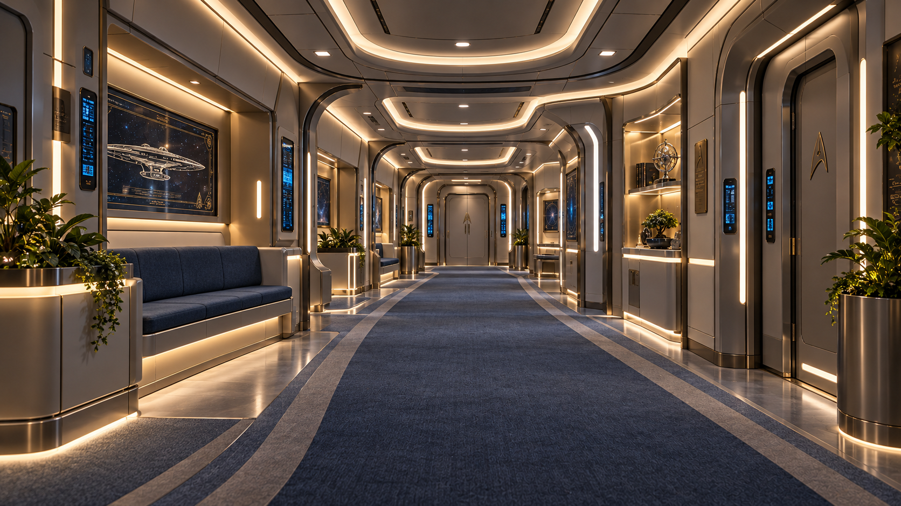

# USS Enterprise Valhalla — Pasillos y corredores

**Ficha de identidad visual — GALAXY REFIT A2 / PASILLOS**  
**Estado del estilo visual:** APROBADO (imagen de referencia elegida)  
**Estado de la geometría:** PENDIENTE de validación modular en Blender / Unreal Engine 5  
**Fecha de referencia:** 15 de octubre de 2026  
**Ámbito:** corredores transitables generales, incluidos corredores residenciales del platillo

---

## 1. Render aprobado

**Archivo asociado:** `Valhalla_Pasillos_A2_Referencia.png`.  
El render fija **estilo, sensación, colores y acabados**, pero **no** el trazado de una cubierta, las dimensiones, la cantidad de puertas ni la ubicación de decoraciones. No deberá interpretarse como un plano estructural.

## 2. Concepto estético

**Galaxy Refit A2: continuidad de la Valhalla, con una temperatura ligeramente más cálida que la del puente principal.**

Son corredores de una gran nave exploradora y habitable: refinados, luminosos y acogedores, pero inequívocamente tecnológicos. Deben resultar agradables para recorrerlos a diario sin parecer un hotel, un centro comercial, una nave militar ni el interior beige de la Enterprise-D original.

- **Puente principal:** frío, técnico, azules más dominantes.
- **Pasillos:** **templados, ligeramente cálidos**, con estructura clara y luz indirecta acogedora.
- **Sala de reuniones:** templada-cálida, distinguida.
- **Despacho del capitán / dormitorios:** cálidos, más íntimos y personalizables según el espacio.
- **Puente de batalla:** frío, táctico, titanio y **sin moqueta**; una excepción deliberada.

## 3. Paleta orientativa de color

| Elemento | Carácter | sRGB de referencia aproximado |
|---|---|---|
| Panelería de pared | Gris perla cálido, limpio y suave | `#CBC9C4` |
| Panelería secundaria | Gris piedra/taupe muy discreto | `#A8A7A2` |
| Marcos y molduras | Titanio satinado plateado, neutro | `#969C9E` |
| Moqueta | Azul grisáceo apagado / gris pizarra suave | `#687586` |
| Tapicería de bancos | Azul marino-gris oscuro | `#34465A` |
| Consolas y controles | Azul océano y cian contenidos | `#397FA9` / `#6FA9C9` |
| Luz predominante | Blanco cálido-neutro, sin amarillo excesivo | Ajustar según iluminación |
| Elementos decorativos | Plantas, metales finos y tonos sobrios | Acentos, no color dominante |

**Estos valores no son mediciones extraídas ni materiales PBR calibrados.** La imagen visual aprobada tiene prioridad; habrá que ajustar al perfil de render y las luces reales de Unreal Engine.

## 4. Materiales y acabados

### Paredes, estructura y techo

- Paneles principales claros en gris perla cálido, preferiblemente mates o semimates.
- Arcos, perfiles y remates en **titanio satinado fino** y superficies metálicas de alta calidad; evitar chapas industriales bastas.
- Techos curvos con luces integradas y detalles técnicos discretos; mantener el lenguaje arquitectónico Galaxy Refit A2.
- Juntas bien resueltas, sin huecos ni destellos en conexiones modulares.

### Suelo — decisión expresa

**Moqueta obligatoria para los corredores habitables representados por esta ficha.**

- Color azul grisáceo sobrio, textura fina y limpia.
- Bordes y uniones discretos, compatibles con el paso entre módulos.
- No sustituir por un suelo metálico reflectante como el del puente de batalla.

### Consolas y decoración

- Pantallas puntuales azul océano/cian, en nichos o junto a puertas.
- Bancos de espera, pequeñas jardineras, paneles informativos y arte estelar **solo donde resulte funcional y verosímil**.
- No repetir plantas, cuadros o bancos en todos los módulos: variar el equipamiento sin perder identidad visual.
- Las puertas se adaptarán al sistema de aperturas y a las necesidades reales del juego.

## 5. Iluminación

- **Más templada que el puente principal** y claramente menos fría que el puente de batalla.
- Luz indirecta uniforme en molduras, techo y perímetros.
- Blanco cálido-neutro; rango **orientativo de partida 3500–4200 K**, no una norma fija.
- Los paneles azules deben aportar contraste, sin teñir todo el pasillo de cian.
- Mantener legibilidad de señalética y tránsito en modo normal y con luces de emergencia.
- Preparar variantes de luz ambiental y de alertas en UE5 sin cambiar el material base.

## 6. Modularidad y reutilización de Voyager

El kit de la **Voyager** es **candidato a fuente de geometría**. Su idoneidad definitiva debe validarse en el modelo real; las capturas no certifican conectores, escala ni radio.

### Aprovechamiento propuesto

- Tramos rectos de varias longitudes.
- Curvos (actuales y eventuales variantes de mayor radio).
- Cruces, uniones en T/Y, extremos, accesos a puertas y turboascensores.
- Volúmenes procedentes de salas especiales, como enfermería y transportador, previa adaptación de función y aspecto.

**Flujo de trabajo:** conservar copia intacta del GLB Voyager → separar y auditar módulos → fijar escala, altura, anchura y perfiles de conexión → transformar un módulo maestro con materiales Valhalla → validar transiciones → generar variantes y montar niveles en Unreal Engine 5.

El sistema debe permitir cambiar un módulo sin reconstruir toda la cubierta. La coherencia física y la transitabilidad tienen prioridad sobre la decoración del render.

## 7. Concepto en estudio: doble anillo de circulación

**Propuesta interesante, TODAVÍA NO APROBADA COMO PLANO:** usar **dos corredores curvos concéntricos**, uno exterior de **radio amplio** y otro interior de **radio menor**, con **dependencias y módulos habitables situados entre ambos**.

Posibilidades:

- Camarotes y salas entre los dos anillos, con accesos desde uno u otro corredor según su función.
- Conexiones radiales entre anillos a intervalos razonables.
- Cruces, ascensores y núcleos de servicio como nodos de circulación.
- Variantes de corredor recto para conexiones a enfermería, transporte, ocio, hangares y núcleos centrales.

**Condiciones de validación:** medir el perfil real del platillo (que puede no ser un círculo perfecto), el radio interior/exterior disponible, la profundidad de las dependencias, el espacio entre corredores, los ángulos y la coincidencia de conectores. El anillo exterior no tiene por qué reutilizar la misma curva escalada que el interior: conviene crear **familias geométricas distintas con ancho y altura compatibles**, no deformaciones arbitrarias.

### Prioridad de geometría

Probar primero un módulo maestro de **radio más grande** para el anillo exterior, conservando la variante pequeña como candidata al anillo interior o a zonas secundarias. Comprobar en Blender el cierre mediante duplicación real antes de fijar el número de módulos por circunferencia.

**La propuesta de doble anillo y el nuevo radio están en evaluación; solo el estilo visual de esta ficha queda aprobado.**

## 8. Criterios de aceptación del estilo

La adaptación tendrá éxito cuando:

1. Un corredor renderizado se reconozca como parte de la **Valhalla A2** sin depender de rótulos.
2. Se perciba **un poco más cálido** que el puente principal, pero sin dominantes amarillas o beige.
3. La **moqueta azul grisácea** se mantenga continua al unir módulos habitables.
4. El titanio sea **elegante, fino y satinado**, sin aspecto de chapa de construcción.
5. Las consolas azules sean visibles pero secundarias.
6. Los conectores reales coincidan sin solapes, escalones ni grietas.
7. La circulación funcione a escala del personaje en Unreal Engine.

## 9. Síntesis para el equipo de modelado

> **Pasillos Valhalla:** Galaxy Refit A2, gris perla cálido, titanio satinado, moqueta azul grisácea, iluminación indirecta templada y pantallas azules discretas. Ambiente de nave de exploración elegante y habitable. Utilizar módulos Voyager como posible esqueleto y validar por separado la futura cubierta de dos anillos curvos.
