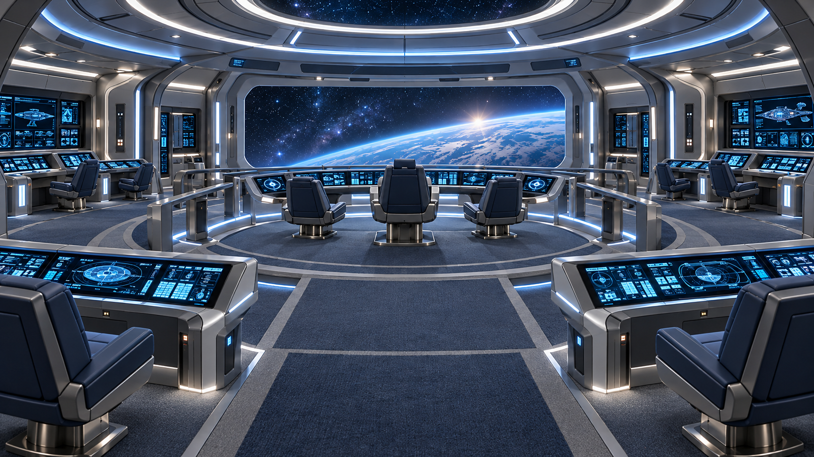

# USS Enterprise Valhalla — Puente principal

**Ficha de identidad visual · GALAXY REFIT A2 (Galaxy Refined)**  
**Estado:** APROBADO — estilo visual definitivo para el puente principal  
**Fecha:** 15 de octubre de 2026  
**Versión:** 1.0  
**Ámbito:** diseño de materiales, color, iluminación y ambiente. **No fija la geometría ni la distribución final del modelo 3D**.

## 1. Imagen de referencia aprobada

**Archivo:** `Valhalla_Puente_Principal_A2_Referencia.png`  
**Resolución:** 1672 × 941 píxeles  
**SHA-256:** `06613753a10b25213dc292ec761708e0ee76820175280d095afabe16b4d36200`

Esta imagen es la referencia estética oficial del puente principal. Sirve para reproducir **la sensación ambiental, los colores, la iluminación y los materiales**, no para copiar necesariamente sus ventanales, consolas, sillas, proporciones o distribución. Se trabajará sobre la geometría del puente real disponible en el proyecto.

## 2. Identidad y objetivo

El puente principal de la **Enterprise Valhalla**, heredera de la clase Galaxy, debe transmitir **autoridad serena, exploración, tecnología avanzada, concentración y profesionalidad**. Conserva la elegancia y habitabilidad de la Enterprise-D, pero modernizada y despojada de la predominancia de beige, marrones y pasteles de TNG.

**Concepto rector:** *una Galaxy modernizada, fría y tecnológica en su centro de mando, sin convertirse en una nave militar oscura*.

En la jerarquía ambiental de la nave, el puente es la zona de mando de **tonalidad más fría**; los pasillos serán templados y los espacios residenciales más cálidos. Todos compartirán una misma familia de materiales A2.

## 3. Paleta cromática

| Elemento | Color / aspecto | Referencia sRGB orientativa |
| --- | --- | --- |
| Paredes y paneles dominantes | Gris perla frío, claro, satinado o mate | `#CDD2D2` |
| Estructura y marcos | Titanio / plata satinada | `#A3ACB1` |
| Revestimientos secundarios | Gris azulado medio | `#6B7D8A` |
| Tapicerías y detalles | Azul pizarra / azul grisáceo profundo | `#3B5368` |
| Consolas: azul tecnológico | Azul océano y azul profundo | `#2869A3` |
| Interfaces: acentos luminosos | Cian moderado | `#3196CF` |
| Moqueta | Gris pizarra con matiz azulado, textura visible | `#495568` |

**Importante:** estos códigos hexadecimales documentan una **aproximación técnica a los colores de la imagen aprobada**; no son mediciones calibradas de sus materiales. El aspecto renderizado de referencia tiene prioridad. Podrán ajustarse en Blender/UE5 para reproducirlo con el sistema de iluminación y la gestión de color reales.

### Proporción visual buscada

- **Dominante:** grises fríos, perla y titanio claro.
- **Secundario:** azul pizarra, especialmente en sillones, paneles puntuales y superficies de consola.
- **Foco:** pantallas y controles azules/cian.
- **Acentos discretos:** señalización funcional y pequeñas luces auxiliares.

No saturar todas las superficies con azul: el azul debe concentrarse en el mobiliario técnico y las interfaces, con predominio de materiales neutros.

## 4. Iluminación

- **Temperatura visual:** neutra con tendencia fría; evitar un tinte azul uniforme de toda la habitación.
- **Luz general:** blanca neutra-fría, difundida e indirecta, sin sombras duras.
- **Luz de detalle:** tiras integradas discretas en techo, zócalos o consolas; reflejos controlados sobre titanio.
- **Consolas:** brillo azul y cian legible, sin sobreexposición ni efecto neón excesivo.
- **Referencias de partida para pruebas en motor:** aproximadamente **4500–5500 K** para luz ambiental/funcional, afinando por render y no como norma rígida.
- **Ambiente:** profesional y concentrado, pero suficientemente luminoso para operaciones normales y permanencias prolongadas.

### Estados operativos previstos

El estilo normal del puente se mantiene como base. Los estados de alerta añadirán cambios funcionales y reversibles: ámbar localizado en **alerta amarilla**, rojo localizado en **alerta roja**, y reducción o redireccionamiento de luminarias durante **emergencias energéticas**. La señalización no debe destruir la legibilidad de las consolas.

## 5. Materiales y superficies

| Elemento | Especificación visual |
| --- | --- |
| Paredes | Panelado gris perla, acabado mate/satinado, juntas suaves |
| Arcos, bordes y soportes | Titanio/plata **cepillado fino**, brillo contenido |
| Muebles técnicos | Carcasas grises y azul grisáceo, pantallas integradas |
| Sillones | Tapicería azul pizarra, mullida, con apoyabrazos y estructura metálica |
| **Suelo** | **Moqueta obligatoria en el puente**, gris azulada, de pelo corto y textura sutil |
| Remates | Bandas e inserciones metálicas discretas; sin exceso de dorados o marrones |

**La moqueta está aprobada como elemento de identidad**, no solo decorativo: refuerza confort, acústica y continuidad con el legado Galaxy. Evitar suelos generales de metal brillante o espejo.

## 6. Interfaz de las consolas

- Predominio de **azul océano, azul técnico y cian**, con información clara y jerarquizada.
- Sobre fondos más oscuros, gráficos luminosos controlados; no reemplazar legibilidad por decoración.
- El azul no implica que todas las funciones tengan el mismo color: **verde**, **ámbar** y **rojo** se reservan cuando el estado, el aviso o la emergencia lo requieran.
- El lenguaje visual puede modernizar las consolas originales, manteniendo coherencia con la Flota Estelar y el estilo A2 de la Valhalla.

## 7. Lo que sí y lo que no queda aprobado

### Aprobado

1. **Estilo Galaxy Refit A2**, más frío y tecnológico que el resto de la nave.
2. Paredes gris perla y estructura titanio/plata satinada.
3. Sillones azul pizarra y **moqueta gris azulada**.
4. Consolas con paleta principalmente azul/cian.
5. Iluminación neutra-fría, integrada y confortable.
6. Imagen adjunta como **referencia visual oficial**.

### No decidido por esta ficha

- Forma exacta del puente, ventanas o pantalla principal.
- Número y distribución de consolas y puestos.
- Geometría definitiva de los muebles, escaleras, barandillas o accesos.
- Texturas PBR finales, mapas UV o valores físicos exactos de roughness/metallic.
- Apariencia de los otros tres espacios de mando (puente de batalla, sala de reuniones, despacho del capitán): **se aprobarán en fichas independientes**.

## 8. Criterios de aceptación al llevarlo a Blender y Unreal Engine 5

- Al compararlo con esta imagen, el puente debe percibirse **claramente frío, moderno y refinado**, sin dominar el beige.
- Las superficies han de leerse como materiales reales (paneles, titanio, tela, moqueta), **no como plástico brillante**.
- El conjunto debe seguir sintiéndose **habitable y propio de una Galaxy**, no militar-industrial.
- Los azules deben concentrarse en pantallas, tapicerías y acentos, evitando que toda la escena quede teñida de cian.
- La iluminación normal debe permitir ver los volúmenes y trabajar sin deslumbramientos.
- El estilo debe adaptarse a la **geometría del modelo 3D existente**, sin exigir replicar las proporciones generadas por IA.

---

**Referencia de continuidad del proyecto:** Puente principal = **frío / tecnológico**; pasillos = **templados / acogedores**; dormitorios = **cálidos** (estándar, oficiales, VIP/capitán/primer oficial). Sala de reuniones, despacho del capitán y puente de batalla tienen sus respectivas fichas pendientes.