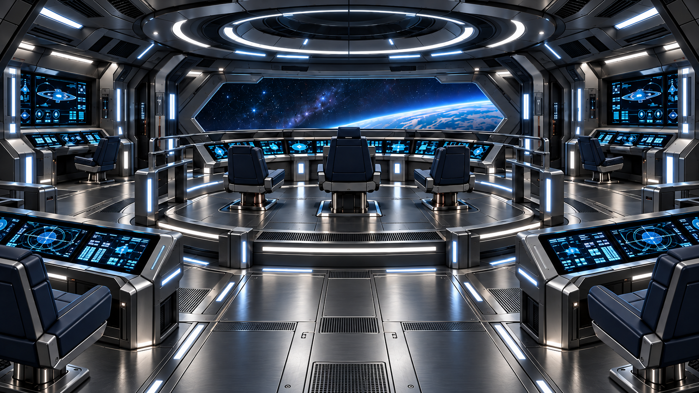

# USS Enterprise Valhalla — Puente de batalla

**Ficha de identidad visual · PUENTE DE BATALLA TÁCTICO**  
**Estado:** APROBADO — estilo visual definitivo  
**Espacio:** Puente de batalla / centro de mando táctico secundario  
**Función:** mando de combate, control táctico, supervivencia operativa, coordinación de crisis y separación de secciones

---

## 1. Imagen de referencia aprobada

**Archivo:** `Valhalla_Puente_de_Batalla_A1_Referencia.png`  
Esta imagen es la referencia estética oficial del **puente de batalla** de la Valhalla. Define la atmósfera, materiales, paleta, iluminación y lenguaje operativo del espacio. La geometría final podrá adaptarse al modelo 3D real, manteniendo esta identidad visual.

---

## 2. Intención visual del espacio

El puente de batalla debe desprender inmediatamente una sensación de **mando táctico, disciplina y preparación para combate**. No es un puente cómodo ni diplomático: es un entorno de trabajo crítico, más duro, más frío y más funcional que el puente principal.

### Sensación buscada
- **Frío**
- **Táctico y utilitario**
- **Preciso, sobrio y contundente**
- **Operativo antes que ceremonial**
- **Tecnológico, resistente y preparado para guerra**

### Regla de identidad
Si el **puente principal** comunica _mando de exploración sofisticado_, el **puente de batalla** debe comunicar _mando de combate y continuidad operativa bajo presión_.

---

## 3. Diferencia respecto al puente principal

### El puente principal es
- más refinado y representativo;
- más habitable;
- con moqueta;
- más abierto al carácter de nave insignia.

### El puente de batalla es
- más compacto y concentrado;
- más frío y militarizado;
- **sin moqueta**;
- con superficies metálicas resistentes;
- con una lectura clara de espacio técnico y de guerra.

---

## 4. Paleta cromática aprobada

La base visual del puente de batalla gira en torno a **titanio premium**, grises oscuros y azules fríos.

| Elemento | Color / aspecto | Referencia sRGB orientativa |
|---|---|---|
| Suelo y placas principales | titanio satinado frío / plata oscura | `#7C838D` |
| Estructuras y marcos | titanio cepillado premium / grafito metálico | `#5D646D` |
| Zonas secundarias | gunmetal / gris antracita técnico | `#394047` |
| Consolas | grafito oscuro con detalles titanio | `#2F353C` |
| Sillones | cuero azul oscuro / azul marino táctico | `#23344A` |
| Pantallas e interfaz | cian eléctrico / azul táctico | `#34B7FF` |
| Iluminación estructural | blanco frío técnico | `#DCE9F5` |
| Sombras / profundidad | negro azulado técnico | `#171D26` |

**Importante:** la prioridad la tiene la imagen aprobada. Estos códigos son una aproximación de trabajo para Blender y Unreal Engine 5.

---

## 5. Materiales y acabados

### Material principal aprobado
**Titanio de alta calidad**, claramente premium y elegante, no chapa industrial basta.

### Características del titanio buscado
- acabado **cepillado fino**;
- reflexión contenida y limpia;
- sensación de material avanzado de nave estelar;
- superficies resistentes pero bellas;
- lectura de lujo funcional, no de obra o maquinaria tosca.

### Materiales complementarios
- grafito técnico semimate;
- paneles metálicos oscuros de precisión;
- perfiles iluminados integrados;
- cristal/pantalla técnica en consolas;
- cuero o cuero sintético azul oscuro en sillones.

### Qué evitar
- planchas de metal bastas o de aspecto de obra;
- moqueta o texturas blandas de puente principal;
- tonos cálidos o decorativos;
- madera, tejidos acogedores o ambiente diplomático.

---

## 6. Suelo aprobado

**Sin moqueta.** Esto queda fijado expresamente.

### Tipo de suelo
- placas modulares de **titanio satinado premium**;
- juntas limpias y precisas;
- rejillas y ventilaciones integradas con criterio;
- tiras de luz o líneas técnicas embebidas;
- acabado elegante, robusto y táctico.

### Sensación buscada
El suelo debe transmitir:
- resistencia;
- limpieza;
- operatividad;
- seguridad;
- diseño militar refinado.

No debe parecer un taller, un hangar ni una obra, sino un **centro de mando de combate de alto nivel**.

---

## 7. Iluminación aprobada

### Carácter de la luz
- fría;
- limpia;
- técnica;
- de alta legibilidad;
- con predominio de blancos fríos y azules.

### Componentes recomendados
- anillo de luz estructural en techo;
- líneas LED frías en suelo y plataformas;
- refuerzos luminosos en barandillas y marcos;
- brillo controlado en consolas;
- sombras nítidas pero no oscuridad dramática excesiva.

### Referencia orientativa para pruebas en motor
- aproximadamente **5000–6500 K** como base,
- afinando según render final y legibilidad.

---

## 8. Consolas y visualización

### Lenguaje visual de interfaz
- pantallas azul/cian muy legibles;
- información densa y táctica;
- trazados, retículas, lecturas de sensores, esquemas de nave y datos operativos;
- menor componente decorativo y mayor densidad funcional.

### Carácter del conjunto
Las consolas deben sentirse como herramientas de guerra y crisis:
- rápidas de leer;
- compactas;
- robustas;
- integradas en la arquitectura.

---

## 9. Sillones y puestos

### Material de referencia
- **cuero azul oscuro** o equivalente sintético premium;
- estructura metálica fuerte;
- bases robustas;
- diseño anguloso y funcional.

### Sensación
- cómodos para operación prolongada,
- pero sin apariencia doméstica;
- claramente más duros y tácticos que los del puente principal.

---

## 10. Composición y arquitectura

### Rasgos generales
- plataforma de mando central;
- escalones o cambios de nivel tácticos;
- barandillas y perímetros funcionales;
- puesto central dominante;
- estaciones periféricas listas para operación continua.

### Impresión espacial
El puente de batalla debe sentirse:
- más recogido;
- más concentrado;
- más blindado mentalmente;
- menos ceremonial;
- más preparado para sostener combate o emergencia extrema.

---

## 11. Relación con otros espacios de la Valhalla

### Comparativa resumida
- **Puente principal:** frío elegante, tecnológico, con moqueta y mayor refinamiento representativo.
- **Sala de reuniones:** templado-cálida, oficial, diplomática y reflexiva.
- **Despacho del capitán:** íntimo, sobrio y personal.
- **Puente de batalla:** frío, táctico, utilitario, sin moqueta y con titanio premium.

---

## 12. Criterios de validación visual

La implementación será correcta si, al verla en Blender o Unreal Engine 5:

1. Se percibe de inmediato como un **puente de combate**.
2. Se distingue claramente del puente principal por su dureza visual.
3. El suelo se lee como **titanio premium**, no como chapa basta.
4. No aparece moqueta ni superficies blandas principales.
5. Los sillones azul oscuro y las consolas tácticas refuerzan la identidad del espacio.
6. El conjunto transmite la idea de:  
   **“si estamos aquí es porque vamos a una situación seria, crítica o de guerra.”**

---

## 13. Resumen ejecutivo

**Estilo aprobado para el puente de batalla de la USS Enterprise Valhalla:**

- ambiente **frío y táctico**;
- arquitectura operativa y compacta;
- **sin moqueta**;
- suelo y estructuras en **titanio premium cepillado**;
- consolas grafito/titanio con pantallas azul-cian;
- sillones en **cuero azul oscuro**;
- iluminación blanca fría con apoyo azul;
- identidad visual de combate, no de representación.

**Definición breve:**  
> _Un puente de mando táctico frío, duro y elegante, construido en titanio premium y orientado completamente a combate, crisis y continuidad operativa._

