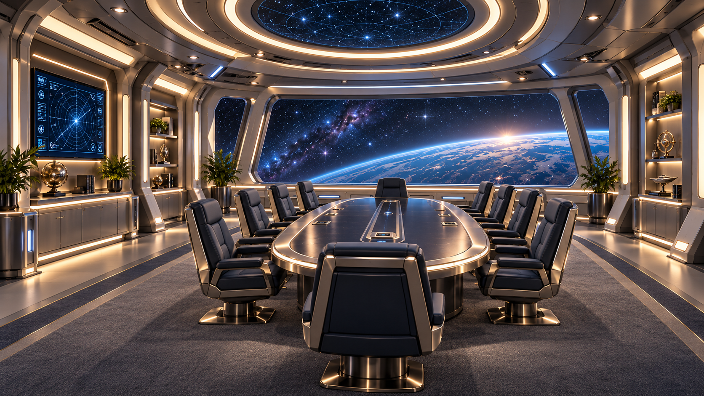

# USS Enterprise Valhalla — Sala de reuniones

**Ficha de identidad visual · GALAXY REFIT A2 (Sala de reuniones / observación)**  
**Estado:** APROBADO — estilo visual definitivo  
**Espacio:** Sala de reuniones situada tras el puente principal, conectada por un pasillo corto  
**Función:** reuniones de oficiales, observación, deliberación estratégica, diplomacia y briefing de misión

---

## 1. Imagen de referencia aprobada

**Archivo:** `Valhalla_Sala_de_Reuniones_A2_Referencia.png`  
Esta imagen es la referencia estética oficial de la **sala de reuniones** de la Valhalla. Sirve para reproducir **la atmósfera, la paleta, la iluminación y los materiales**. La geometría final podrá adaptarse al modelo 3D real, manteniendo el mismo lenguaje visual.

---

## 2. Intención visual del espacio

La sala de reuniones debe sentirse como un espacio **más cálido y humano que el puente principal**, pero claramente integrado en la misma nave. No es un comedor ni un camarote: es una sala de mando serena y distinguida.

### Sensación buscada
- **Templada-cálida**
- **Oficial y elegante**
- **Reflexiva y diplomática**
- **Conectada visualmente al puente, pero menos tecnológica**
- **Cómoda, sobria y habitable**

### Regla de identidad
Si el **puente principal** comunica _mando técnico y control inmediato_, la **sala de reuniones** debe comunicar _criterio, estrategia, conversación y observación_.

---

## 3. Paleta cromática aprobada

La sala de reuniones conserva la familia de materiales de la Valhalla, pero aumenta la calidez respecto al puente.

| Elemento | Color / aspecto | Referencia sRGB orientativa |
|---|---|---|
| Paredes principales | gris perla cálido | `#CFCBC4` |
| Estructuras y marcos | titanio satinado / plata suave | `#A8A39A` |
| Mesa principal | grafito templado / antracita suave | `#2F343B` |
| Sillas | azul marino muy oscuro / gris azulado profundo | `#253246` |
| Moqueta | gris medio cálido con matiz azul sutil | `#6A6C73` |
| Luz ambiental dominante | marfil cálido / blanco cálido refinado | `#F1E2C8` |
| Acentos tecnológicos | azul suave / cian discreto | `#6FAEE8` |
| Vistas y pantallas | azules fríos espaciales | variable según escena |

**Importante:** los hexadecimales son una aproximación técnica. La prioridad la tiene la imagen aprobada como referencia estética global.

---

## 4. Temperatura visual

### Nivel térmico del espacio
- **Puente principal:** frío / tecnológico
- **Sala de reuniones:** templado-cálido / oficial / distinguido
- **Dormitorios:** cálidos / habitables

La sala de reuniones debe colocarse **entre el puente y los espacios privados** en sensación ambiental.

---

## 5. Materiales y acabados

### Materiales principales
- panelería lisa en **gris perla cálido**;
- marcos y nervaduras en **titanio satinado**;
- mesa central con acabado **grafito oscuro semimate** y detalles metálicos refinados;
- sillas ejecutivas tapizadas en **azul muy oscuro o gris azulado profundo**;
- moqueta continua de alta calidad, más confortable que industrial;
- nichos integrados y superficies decorativas discretas;
- ventanales panorámicos como elemento protagonista.

### Qué evitar
- beige anaranjado noventero dominante;
- brillo excesivo tipo sala clínica;
- estética demasiado militar o agresiva;
- exceso de pantallas o de interfaz en las paredes.

---

## 6. Iluminación aprobada

### Carácter de la luz
- **Más cálida que la del puente**;
- indirecta y envolvente;
- elegante y regulada;
- con apoyo puntual sobre mesa, nichos y perímetro.

### Componentes recomendados
- aros o líneas de luz cálida integrados en techo;
- luz ambiental perimetral en paredes y mobiliario;
- pequeños acentos azules muy medidos en paneles técnicos;
- iluminación natural simulada desde ventanales, equilibrada con el exterior espacial;
- luz suficiente para reuniones, pero sin la frialdad operativa del puente.

### Referencia orientativa para pruebas en motor
- aproximadamente **3200–4000 K** como base de ambiente,
- con posibilidad de subir levemente si la escena necesita más neutralidad,
- siempre buscando un aspecto **cálido, refinado y no doméstico**.

---

## 7. Mobiliario y composición

### Elemento central obligatorio
- **Mesa de reuniones alargada** como pieza protagonista.

### Mobiliario asociado
- sillas ejecutivas cómodas, sobrias y robustas;
- nichos o vitrinas integradas con elementos decorativos discretos;
- alguna pantalla auxiliar o panel de situación, sin robar protagonismo a la sala;
- vegetación ornamental moderada;
- posibles objetos diplomáticos, maquetas o piezas simbólicas;
- ventanal panorámico principal orientado al espacio.

### Notas de puesta en escena
La sala debe poder acoger:
- reuniones del capitán con su plana mayor;
- encuentros diplomáticos reducidos;
- briefings de misión;
- conversaciones de alto nivel.

---

## 8. Moqueta

**La moqueta se mantiene y queda aprobada** también en la sala de reuniones.

### Función estética y espacial
- conserva continuidad con la Valhalla;
- refuerza confort acústico y visual;
- aporta sensación de nave habitable;
- suaviza el contraste con metal y cristal.

### Acabado recomendado
- gris medio o gris cálido con matiz azulado discreto;
- textura fina y elegante;
- aspecto premium, no doméstico.

---

## 9. Relación con otros espacios

### Comparativa resumida
- **Puente principal:** más frío, azul, centrado en sistemas y control.
- **Sala de reuniones:** más cálida, representativa y reflexiva.
- **Despacho del capitán:** más íntimo y personal que la sala de reuniones.
- **Puente de batalla:** más funcional, compacto y austero.

---

## 10. Criterios de validación visual

La implementación será correcta si, al verla en Blender o Unreal Engine 5:

1. Se percibe inmediatamente como **parte de la Valhalla**.
2. Resulta **más cálida que el puente principal**, pero no doméstica.
3. El espacio transmite **autoridad tranquila, estrategia y observación**.
4. La mesa central y el ventanal dominan la composición.
5. La moqueta y el mobiliario refuerzan el confort y la nobleza del espacio.
6. Los azules aparecen como acentos de continuidad, no como color dominante global.

---

## 11. Resumen ejecutivo

**Estilo aprobado para la sala de reuniones de la USS Enterprise Valhalla:**

- base **Galaxy Refit A2**;
- temperatura **templado-cálida**;
- elegancia **oficial y serena**;
- materiales en gris perla, titanio satinado, grafito y azul oscuro;
- moqueta premium;
- iluminación cálida refinada;
- identidad visual intermedia entre puente y espacios más humanos.

**Definición breve:**  
> _Una sala de reuniones / observación distinguida, panorámica y habitable, más cálida que el puente principal, pensada para deliberar, observar y decidir._

