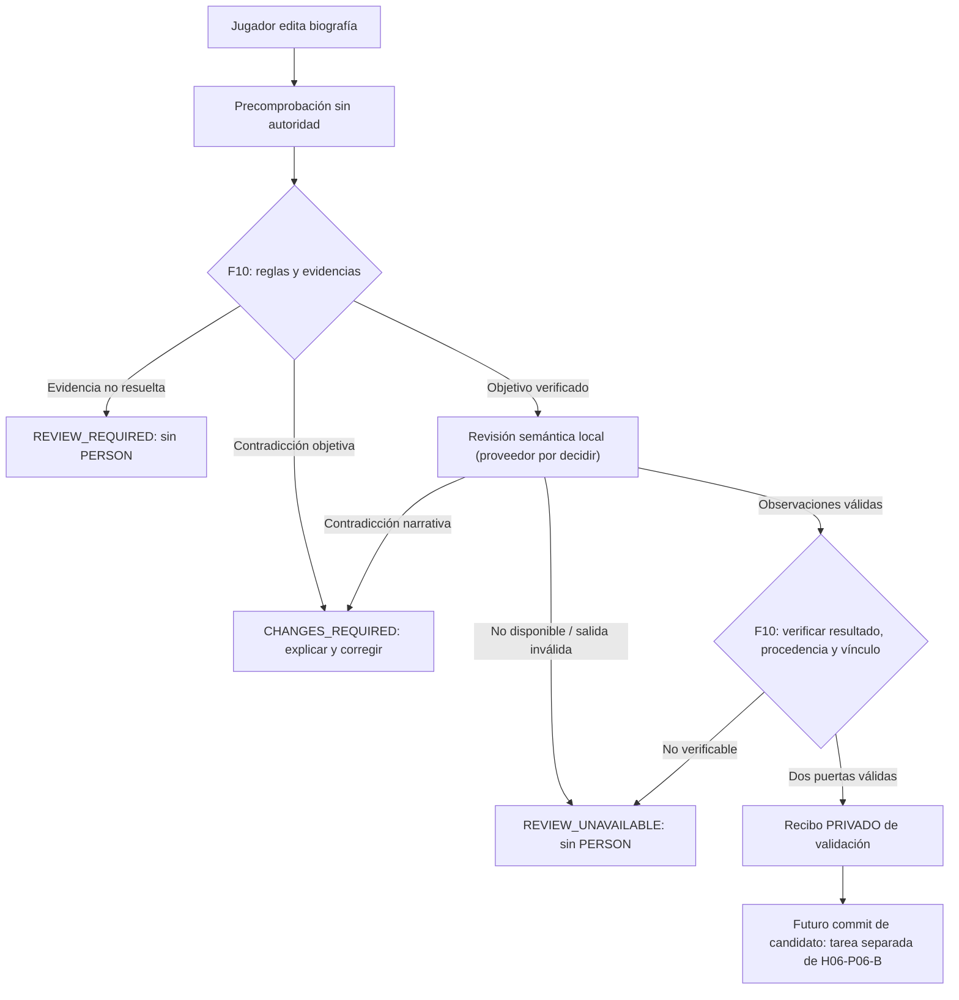

# H06-P06-A3 — Autoridad de evidencias y revisión semántica local (propuesta)

**Fecha:** 14-11-2026. **Autor:** ChatGPT, diseño F10/HOST. **Estado:** CONTRATO DE ARQUITECTURA PROPUESTO, **NO** conectado al producto. **CoreRPG:** pin `76a7b7b485616d8c4994f384a90f123bf333591d` intacto.

Contrato aditivo: [f10_biography_evidence_semantic_boundary_v0.1.json](../../../../sistemas/gameplay/character_creation/f10_biography_evidence_semantic_boundary_v0.1.json). No modifica las dos puertas de la PR #152 ni la política de edad de las PR #153/#154. No elige proveedor de IA ni crea un servidor.

## 1. Qué problema queda

El código nativo ya rechaza edad jugable insuficiente para 22 especies, bloquea tres especialidades sin regla de madurez y cinco especies DLC Delta en la campaña principal. Sin embargo, falta saber **quién** respalda los antecedentes biográficos y qué IA, en su caso, revisa su coherencia. El constructor de producto `BiographyValidator()` no tiene proveedores reales. Sin ellos devuelve revisión pendiente/no disponible. Esta entrega es preparación, no resolución de esa dependencia.

No confundir tres niveles:

1. **Declaración:** lo que escribe el jugador al diseñar una persona ficticia, como «tengo 20 años y entrené karate desde los ocho».
2. **Evidencia interna:** fuente registrada de F10 que sustenta una afirmación según una regla conocida, la cronología y el contexto de campaña.
3. **Hecho autoritativo:** el que eventualmente confirma y publica CoreRPG tras el commit separado, nunca una cadena enviada por un cliente o una IA.

Un personaje de nueva creación todavía no tiene PERSON en CoreRPG. No podemos exigirle un expediente personal ya existente ni inventar uno. La solución futura requiere una **política explícita de formación de antecedentes iniciales**, verificando reglas, plausibilidad y procedencia, antes de publicarlos. Un `evidence_ref` suministrado por el jugador es texto, no un comprobante. Una mera afirmación de mayoría de edad tampoco acredita por sí sola madurez individual.

## 2. F10 debe distinguir las fuentes

| Afirmación | Qué se comprueba | Qué NO demuestra |
|---|---|---|
| Edad mínima jugable | Tabla versionada de 25 especies de F10 y cronología | Adultez biológica universal |
| Madurez individual | Regla/atestación interna aprobada para etapa vital y caso | `adult_equivalent_status=true` del cliente |
| Origen o ciudadanía | Contexto de campaña, normas y hechos respaldados | Nacionalidad por especie o planeta |
| Estudios y certificados | Antigüedad, duración y fuente de formación coherente | Títulos por afición o simple autodeclaración |
| Experiencia anterior | Línea temporal y compatibilidad de actividades | Maestría profesional por elocuencia de la biografía |
| Aptitud institucional | Reglas separadas de admisión y plazas reales | Que «ser adulto» dé plaza automáticamente |

**Importante:** `F10_VALIDATED_INITIAL_BACKGROUND_SOURCE` describe un origen de evidencia que *podría* definirse internamente en un futuro, no un mecanismo disponible. Un registro interno necesita fuente verificable, ámbito, identidad de emisor y vinculación exacta al borrador. Ni los valores JSON ni un hash aislado son credenciales. Las afirmaciones no acreditadas quedan pendientes, no se «autocompletan» con IA.

## 3. Dos puertas y flujo propuesto

La IA revisaría, por ejemplo, si es razonable que una persona de veinte años estudie en la Academia tras diez años de deporte. Puede detectar contradicciones, pero **no inventa certificados, no corrige el texto sin permiso y no otorga competencias**. F10 comprobará los resultados y conservará la autoridad. Una prueba aislada con «IA que responde sí» no puede aprobar un personaje en producción.

### Separación de las interfaces existentes

- `BiographyAuthority::resolves`: comprueba evidencias de afirmaciones pendientes contra fuentes internas registradas. No puede anular rechazos deterministas ni suplir la fecha de campaña aún desconocida.
- `SemanticEvaluator::review`: revisa la misma biografía canónica, con un formato acotado de contradicciones/sugerencias.
- `BiographyAuthority::verify`: valida la procedencia de revisión, que el evaluador sea esperado, el borrador/contexto/versiones coincidan y que ninguna regla objetiva sea anulada.
- `BiographyValidator::eligible`: revalida después la vigencia de borrador, sesión, contexto y recibo antes de cualquier operación de commit futuro.

Si cambia la biografía, una regla de madurez, la política semántica, la versión del modelo o la generación de sesión, se exige repetir la revisión. **El compromiso no depende solo de guardar una huella SHA-256**: esa huella vincula datos, mientras que la autoridad depende de la ruta interna que los verificó.

## 4. Proveedor de IA: decisión pendiente

**Preferencia arquitectónica propuesta:** ejecución local y capacidad de funcionar sin Internet, reutilizando un proveedor de IA que el usuario configure y autorice. La eventual conexión a un proceso local por loopback será una **opción condicionada a decisión de producto**, no una obligación. No escoger modelo, puerto, librería o servicio sin verificar compatibilidad.

- Solo remitir los campos necesarios de la biografía y el contexto autorizado.
- Nunca transmitir secretos ocultos del universo ni datos privados irrelevantes.
- Exigir una salida estructurada y verificable; una respuesta que diga «APROBADO» por sí sola no sirve.
- Tratar la biografía, los campos del jugador y la salida del modelo como datos no confiables; evitar instrucciones de prompt que pretendan saltarse la puerta objetiva.
- No registrar por defecto texto médico/familiar o biografías completas en logs. Solo códigos y campos permitidos en diagnósticos.
- Si el modelo no está disponible o la respuesta es incompleta/incorrecta, devolver `REVIEW_UNAVAILABLE` y conservar el borrador.
- No exigir nube, servidores públicos, claves de terceros o infraestructura criptográfica desproporcionada en el juego local.

## 5. Casos de ejemplo (sin ejecución en producto)

| Situación | Resultado esperado |
|---|---|
| Humano de 17 años | `CHANGES_REQUIRED`, no IA ni PERSON |
| Humano de 18 años, sin evidencia interna de madurez | `REVIEW_REQUIRED` |
| Nacimiento en el año de umbral 2365 con inicio 2383 sin día/mes | `PLAYABLE_AGE_UNDECIDED` |
| Romulano de 25 años | Supera solo mínimo de especie; acceso político a Academia por separado |
| Ocampano de 2 años en juego principal | `DLC_DELTA_UNAVAILABLE` |
| Cambiante que se presenta como adulto | `SPECIAL_MATURITY_RULE_REQUIRED` |
| Biografía con título imposible para su edad | Rechazo objetivo si regla verificable; si no, revisión de coherencia |
| Modelo desconectado | `REVIEW_UNAVAILABLE`, sin recibo utilizable |
| Jugador adjunta `validated_creation_ref` falso | `CHANGES_REQUIRED` |
| Dos puertas aceptadas hipotéticamente | Solo recibo privado; no PERSON ni ingreso hasta fase posterior |

## 6. Criterios de entrega, pruebas y reparto

**ChatGPT — este corte:** contrato JSON versionado, inventario de evidencias, puertos, decisiones y regresión estática bajo `test_f10_*.py`. Las pruebas verifican el contrato, **no** el funcionamiento de la IA ni la autenticidad de antecedentes ficticios.

**Codex — siguiente corte (GPT-6, razonamiento Alto):** implementar un origen de evidencias F10 aprobado y mínimo, adaptador semántico real o su infraestructura de selección tras decisión del usuario, binding a la identidad de borrador/reglas, pruebas negativas de procedencia, modificación de biografía y fallo de proveedor, sin publicar PERSON. Mantener PR Draft y auditoría independiente.

**Decisiones de producto aún abiertas:** (1) política autoral que permite acreditar madurez individual de un personaje que todavía no tiene PERSON; (2) proveedor/modelo local o mecanismo alternativo conforme a las dos puertas; (3) fecha completa de campaña; (4) reglas de madurez de cambiantes, jem'hadar y vorta. Estos puntos no se inventan para cerrar una fase.

**Estado al final de esta entrega:** H06-P06-A3 **PLANIFICADO / CONTRATO PROPUESTO**; H06-P06-A, HU-08 y M1 **PARCIALES / NO CERTIFICADOS**. No se modifica CoreRPG, H03/H04, F11 ni se inicia H07.
