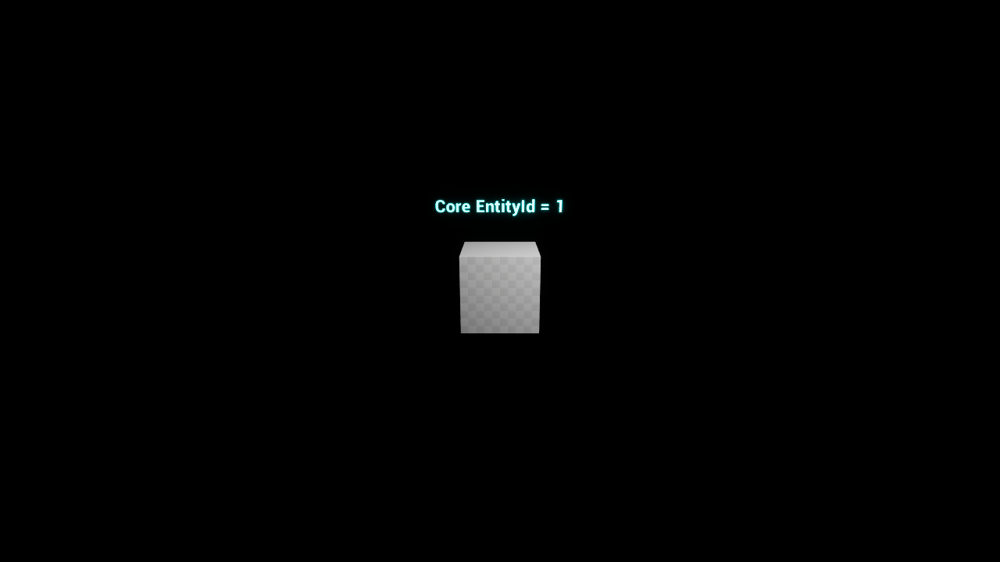

# F02: entrega técnica para auditoría independiente

Fecha: **29 de octubre de 2026, Europe/Madrid**. Rama: `codex/f02-core-ue5-integration-20261029`. Repositorio: `robdor80/Videojuego_StarTrek`.

## 1. Estado de F02

**PARCIAL en términos de cierre global; laboratorio mínimo C++/UE5 completado técnicamente y preparado para auditoría.** Existe una conexión funcional, compilada y ejecutada entre CoreRPG real y Unreal Engine 5.8.2. Se ha pasado de documentación a estado/acciones/proyección/persistencia reales y Actors renovables. F02 permanece abierta; el cierre corresponde a la auditoría de ChatGPT y a las puertas oficiales, incluidas revisión/aceptación y posterior merge autorizado. No se cambia `ESTADO_GLOBAL.json` ni se cierran fases posteriores.

## 2. Repositorios y referencias

| Referencia | SHA inicial | SHA al terminar el desarrollo ejecutable |
|---|---|---|
| CoreRPG local y remoto `main` | `4f282863737bcd8f5add401202a9e1064c133672` | El mismo; cero modificaciones |
| Star Trek `main` local original | `7ee52d59427ba9f1e027dd78200b938c37687f86` | El mismo; no se actualiza ni se modifica |
| Star Trek `main` remoto / base del worktree | `00822e24ecd2333988e5b6369be1ae9e3089de01` | El mismo; no se fusiona la PR |
| Star Trek rama F02 | Base `00822e24ecd2333988e5b6369be1ae9e3089de01` | Código probado `c842b60` (SHA completo en `evidencias_20261029/results.json`); los commits siguientes añaden la entrega documental |

La punta final publicable de toda la entrega es la referencia de la rama/PR: evita incluir un SHA autorreferencial dentro del mismo commit. Los hashes SHA-256 de binarios y pruebas identifican exactamente los artefactos ejecutados. Ver [auditoría operativa](AUDITORIA_OPERATIVA_2026-10-29.md).

## 3. Desarrollo y reutilización por paso

| Paso | Trabajo existente aprovechado | Código/evidencias nuevas | Criterios y pendientes |
|---|---|---|---|
| P01 | Auditoría remota, headers/CMake/tests actuales de Core, ADR y ejemplo de Host autorizado | Build real de Core con Content JSON; 436 casos descubiertos; auditoría actual con versiones/SHAs | Contraste y compilación cumplidos. No hay defecto Core que requiera parche |
| P02 | Inventario JSON, matriz de propiedad, 24 fuentes y 73 selectores, 12 fronteras P03 | Correspondencia de cada adaptador con API actual; inventario de entradas con hashes | Inventario reutilizado y validado. Reloj/agendas/eventos/payloads Trek no se inventan |
| P03 | ADP-01/04/07/08/09/10, secuencias S1/S6 y handoff H01–H04 | DLL C ABI v1, 15 tests, proyecto Unreal, GameInstanceSubsystem, Actor, 5 tests UE y demostración gráfica | Corte mínimo real conseguido. Reglas completas de mando y Sensores siguen pendientes en sus fases |
| P04 | Registro de 13 fallos, 6 ejes y 16 pruebas; validadores originales | Rechazos reales, revisión, permiso revocado, ámbito de sesión, thread affinity, memoria/buffers, RNG, corrupción, logs, CI nativa | Matriz detallada debajo. No se atribuye semántica Trek a un permiso mínimo de laboratorio |
| P05 | Plan de 11 paquetes/13 invariantes y criterios de cierre oficiales | Informe, manifiestos, reproducción, publicación GitHub/Drive y PR Draft | Preparado para revisión; decisión final externa pendiente. Ningún paquete posterior se marca cerrado |

Archivos creados: `desarrollo/integration/f02/` (CMake, API, implementación, tests, reproducción, colección de evidencias, documentación y proyecto Unreal completo de código/configuración), `.github/workflows/f02-native-integration.yml`, esta adenda y sus evidencias. Se añade un enlace de actualización al README F02. El [manifiesto de archivos](ARCHIVOS_ENTREGA_2026-10-29.json) enumera las rutas exactas. Ningún archivo de Core ni recurso artístico se incluye en el diff.

## 4. Integración C++

Una sesión crea un único `WorldState` y su `RandomStreams` en la DLL; genera tres entidades reales, devuelve identidad autorizada, comprueba existencia, ejecuta `PlaceEntityAction` y `StreamRollAction` mediante `ActionEngine`, captura/serializa y recupera mediante `Persistence`. El fixture tiene conocimiento real y utiliza formato de guardado v3. Las pruebas verifican contención, byte-identidad del estado cuando hay rechazo y continuación del siguiente valor RNG tras restauración. El test roundtrip escribe y lee un archivo real; la recuperación crea otra sesión desde ese archivo.

La API pública del Host no expone Core, WorldState, STL ni asignaciones entre módulos. Los permisos se revalidan al ejecutar. Los ámbitos efímeros impiden reutilizar el mismo número de entidad desde otra sesión o después de un restore. La política Host es mínima y explícita; no se implementa una cadena de mando ficticia.

Los tests de asignación fallida pertenecen a la suite real del Core. No se ha forzado un agotamiento de memoria de Windows/Unreal ni se afirma una prueba de todas las excepciones posibles del Host; su frontera captura excepciones y la separación de allocators se comprueba mediante compilación/enlace/ejecución de los dos módulos.

Compilación **Release x64 correcta** con CMake/MSVC. **15/15 tests nativos superados**. Core se compila desde su checkout original y no se copia al repositorio Trek. [Código y reproducción](../../../../../../desarrollo/integration/f02/README.md).

## 5. Integración Unreal Engine

Instalación comprobada: `C:/Program Files/Epic Games/UE_5.8`, **5.8.2, CL 56702186**. Proyecto ejecutado: `C:/Users/andro/Documents/ChatGPT/F02_Run_20261029/ue/F02CoreLab.uproject`. Es independiente de los proyectos originales y sólo usa recursos básicos del motor.

Build `F02CoreLabEditor Win64 Development`: **correcto**. El módulo importa la DLL por ABI C, comprueba versión y SHA y mantiene la sesión en `UGameInstanceSubsystem`. Actor/Blueprint sólo tiene el texto diagnóstico; carece de acceso mutante al Core. Todas las operaciones de sesión se ejecutan en el hilo propietario/Game Thread.

Pruebas Editor automatizadas con `-NullRHI`: **ActorLifecycle, CorruptLoad, Projection, HostRecovery y ThreadAffinity, 5/5 correctas, 0 avisos en la ejecución final**. ActorLifecycle crea un Actor real, lo destruye y comprueba continuidad lógica, recrea otra representación, aplica una acción, guarda/carga desde disco y repite destrucción/recreación con la misma identidad. La repetición de representación no crea otro Actor ni otra entidad.

Demostración adicional **gráfica DX11, 1280×720**, ejecutada con `UnrealEditor.exe -game`: cuatro etapas `pass=1` en el log; captura generada por el motor después de restaurar. Se inspeccionó la captura: cubo con rótulo **Core EntityId = 1**. No se necesita intervención humana pendiente para esta demostración. No se afirma consola de Sensores jugable, empaquetado distribuible ni medición de rendimiento.



## 6. Seguridad y conservación

El checkout original conserva **19.030 archivos con idénticas rutas, tamaños y mtime**. Los 21 elementos Git no versionados iniciales permanecen; el HEAD local y las fuentes de Core no cambian. La comparación se limita a metadatos, no a SHA de todos los archivos artísticos. No se ejecutaron reset/clean/restauraciones ni se copiaron modelos, PBR, Blender, USS Sutherland, Valhalla, recursos de colisiones/puertas o TABULA RASA al laboratorio.

La construcción se limita a cuatro acciones paralelas, con compilación y pruebas pesadas secuenciales. Las evidencias de Drive tienen `shared=false` y sólo permiso de propietario, comprobados mediante lectura de metadatos. No se publican credenciales, modelos originales ni el motor Unreal. Se escanearon los logs para patrones de credenciales antes de empaquetarlos.

## 7. Pruebas: recuento final exacto y comandos

| Suite final | Superadas | Fallidas | Omitidas |
|---|---:|---:|---:|
| CoreRPG, Content JSON habilitado | 432 | 0 | 4 |
| Integración nativa real | 15 | 0 | 0 |
| Integración Unreal real | 5 | 0 | 0 |
| Unittest del validador documental F02 | 9 | 0 | 0 |
| **Total de casos** | **461** | **0** | **4** |

Además pasan los dos validadores documentales y las cuatro etapas de la demostración gráfica; no se suman como casos unitarios. Las cuatro omisiones de Core son el caso de manifiesto ilegible cuando el sistema aplica permisos y tres casos de symlinks cuando el entorno los soporta. Sus nombres exactos figuran en `core-tests.xml`; no se presentan como pruebas superadas.

Entorno: Windows 11 25H2 `10.0.26200.9711`; Intel i9-14900HX; RAM 32 GB; RTX 4070 Laptop GPU; Visual Studio 18.9.1; MSVC 19.51.36256; SDK 10.0.26100.0; CMake 4.4.3; Python 3.10.11; Git 2.52.0.windows.1; UE 5.8.2.

Comandos realmente ejecutados, con rutas equivalentes completas en los logs:

```powershell
cmake -S <CoreRPG> -B <evidencias>/core-build -G 'Visual Studio 18 2026' -A x64 -DBUILD_TESTING=ON -DCORERPG_BUILD_CONTENT_JSON=ON
cmake --build <evidencias>/core-build --config Release --parallel 4
ctest --test-dir <evidencias>/core-build -C Release --output-on-failure --parallel 4
cmake -S desarrollo/integration/f02 -B <evidencias>/bridge-build -G 'Visual Studio 18 2026' -A x64 -DCORERPG_SOURCE_DIR=<CoreRPG>
cmake --build <evidencias>/bridge-build --config Release --parallel 4
ctest --test-dir <evidencias>/bridge-build -C Release --output-on-failure
./desarrollo/integration/f02/run_f02.ps1 -Stage Unreal -CoreSource <CoreRPG> -BuildRoot <F02_Run_20261029>
./desarrollo/integration/f02/run_f02.ps1 -Stage TestUnreal -CoreSource <CoreRPG> -BuildRoot <F02_Run_20261029>
./desarrollo/integration/f02/run_f02.ps1 -Stage Demo -CoreSource <CoreRPG> -BuildRoot <F02_Run_20261029>
python desarrollo/tools/validation/validate_f02_contracts.py
python -m unittest discover -s desarrollo/tools/validation -p test_validate_f02_contracts.py -v
python desarrollo/tools/validation/validate_f02_p05_plan.py
```

### Contraste de las 16 pruebas oficiales P04

| Caso | Evidencia actual | Límite |
|---|---|---|
| T01 | UE ActorLifecycle y demo: identidad al destruir/recrear y restaurar | Cumplida en fixture real |
| T02 | Suite Core de catálogos/Content JSON ejecutada | Pack Trek de producción pendiente |
| T03 | `f02.denied/invalid/stale`: permiso revocado, operación inválida, revisión obsoleta; sin efectos | Autoridad completa de Flota pendiente |
| T04 | ObserverView/ContextBuilder y UE Projection sin entidad oculta | Resolver Sensores/contactos relativo al observador pendiente |
| T05 | Roundtrip real de identidad/contención/conocimiento/RNG y bytes | No historia/tiempo/agendas inexistentes |
| T06 | Demo opera sin IA ni red del videojuego | Consola Sensores/fallo de proveedor IA no implementados |
| T07 | Permiso mínimo revocado y binding antiguo denegados antes de efectos | Respuesta IA tardía y delegación temporal Trek pendientes |
| T08 | UBT compile/link y ejecución real en MSI | Limitado a versiones auditadas |
| T09 | Suite Core compilada/ejecutada localmente; CI nativa adicional | Mayor evidencia que la observación remota previa |
| T10–T14 | Validadores F02 originales y nueve tests pasan; hashes y ejes conservados | Comprobación documental separada de runtime |
| T15 | No hay reintento ciego ni transporte asíncrono | Reconciliación de timeout de órdenes no implementada |
| T16 | Corrupción/truncamiento/versión incompatible rechazados; estado/RNG y Actor preservados | Migraciones no implementadas |

### Incidencias de las ejecuciones anteriores

1. Herramienta de worktree gestionado: restricción de carpetas; resuelto con worktree Git aislado autorizado.
2. Primer build UE: PCH no encontrado por codificación de ruta acentuada UBA/MSVC. Resuelto usando BuildRoot ASCII; script lo exige antes de compilar UE.
3. Primer intento de suite UE: crash en el harness por inicialización doble del mundo. Corregido utilizando `CreateWorld` con sus valores de inicialización una sola vez. No se atribuye el crash a Core.
4. Segundo intento: cinco casos correctos, tres con avisos por falta de WorldContext; el wrapper sólo contabilizaba éxitos sin avisos. Se registró el contexto y se corrigió el contador. Ejecuciones finales: cinco éxitos, cero avisos.
5. Primera captura: el pawn por defecto tapaba parte del rótulo. Se suprimió el pawn del GameMode de demostración; captura final inspeccionada.

Los logs de los fallos se conservan junto a los finales. El recuento de la tabla corresponde a la suite final, no oculta el historial de intentos.

## 8. Publicación GitHub

Commits de desarrollo: `02ba20c` (integración), `59c528a` (harness/toolchain/CI), `c842b60` (ciclo/recuperación/captura). `f17120f` añade auditoría, resultados y manifiestos; un commit posterior registra los enlaces de publicación. Rama específica publicada; [PR #60 **Draft a main**](https://github.com/robdor80/Videojuego_StarTrek/pull/60), verificada abierta y sin conflictos, sin fusión ni borrado de rama.

Validación adicional independiente de Windows: [GitHub Actions, integración nativa real, run 40894930154](https://github.com/robdor80/Videojuego_StarTrek/actions/runs/40894930154), **success** sobre `f17120fb911adee9e746c0b8c4b94b2f5fca6325`. Esa CI compila el Core fijado y ejecuta los 15 tests del Host en Linux. No sustituye las pruebas UE5 ejecutadas en MSI ni se suma otra vez al recuento de casos.

Se conservan directamente en GitHub fuentes, configuración, scripts, tests, inventario, XML/JSON resumidos y captura de 51 KB. Los paquetes binarios y logs se publican en Drive para mantener la política de almacenamiento. El guardarraíl Git se ejecuta antes de cada commit y no presenta infracciones.

## 9. Publicación Google Drive y custodia local

Carpeta comprobada: [Videojuego Star Trek / Planificacion 1 / F02 - Integracion CoreRPG UE5](https://drive.google.com/drive/folders/1mNjcJrP0JIyqATyYo56zoJG0NVYCUL5D). Subcarpetas 01_Capturas, 02_Videos, 03_Logs, 04_Compilaciones y 05_Informes. No se grabó vídeo; esa carpeta está vacía y no se afirma otra cosa.

**Cinco archivos subidos y confirmados por lectura posterior de metadatos:** logs/resultados ZIP; binarios propios/saves sintéticos ZIP; captura PNG; resultados JSON; inventario original de metadatos/clasificación Git ZIP, sin contenidos artísticos. Nombres, tamaños, SHA-256 local, finalidad, plataforma, prueba, ruta local, URL y estado están en [EVIDENCIAS_EXTERNAS_2026-10-29.json](EVIDENCIAS_EXTERNAS_2026-10-29.json). El índice incluye los hashes de cada miembro de los ZIP. El conector confirma tamaño/destino/permisos, pero no devuelve checksum remoto; se declara esa limitación explícitamente.

Custodia local: `C:/Users/andro/Documents/ChatGPT/Planificación 1/F02_evidence_20261029` y `C:/Users/andro/Documents/ChatGPT/F02_Run_20261029/publish`. Fuentes: worktree `C:/Users/andro/Documents/ChatGPT/Planificación 1/f02-integration`. No se eliminan builds, logs ni evidencias.

## 10. Pendientes y criterios de cierre

Las etapas A/B y los escenarios de compatibilidad **aplicables al laboratorio** se han ejecutado. No queda un bloqueo técnico que impida inspeccionar este corte mínimo. Quedan la revisión independiente, aceptación de la frontera para el juego y decisión de cierre. La puerta oficial de revisión/merge no se satisface con una PR en borrador ni se ejecuta de oficio.

Persisten capacidades que el Core o el dominio aún no implementan en este alcance: reloj de campaña y agenda persistente, event store causal, autoridad jerárquica Trek, sensores operativos, contactos/dossiers, migraciones completas, transporte/IA y reconciliación de timeout. Deben resolverse en sus fases con APIs verificadas; no se fabricaron sustitutos. F03–F06/F08 y los 13 invariantes de la guardia completa no quedan certificados por este cubo. F07 artístico permanece intacto. No hay pasos manuales imprescindibles pendientes para repetir la prueba autónoma; se requiere acceso al MSI/UE y a las fuentes indicadas.

## 11. Dictamen técnico

**Preparada para la auditoría independiente de ChatGPT.** La conexión CoreRPG↔Unreal ya es real y reproducible; identidad, ciclo visual, acción, persistencia, RNG y proyección se apoyan en pruebas ejecutadas. Se recomienda revisar primero fuentes del puente, pruebas UE y los tres informes de resultados, contrastar límites de seguridad/memoria/hilos y después decidir la madurez exacta de F02. No se recomienda inferir que el videojuego o la guardia de Sensores estén terminados.
