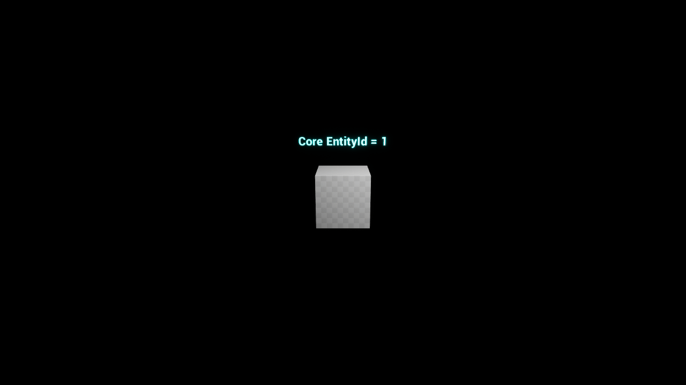

# PR #60: corrección de Represent() para la auditoría final

**29-10-2026, Europe/Madrid.** Respuesta técnica al [comentario de auditoría independiente](https://github.com/robdor80/Videojuego_StarTrek/pull/60#issuecomment-6500133155). Misma rama `codex/f02-core-ue5-integration-20261029` y [PR #60](https://github.com/robdor80/Videojuego_StarTrek/pull/60), mantenida en Draft y sin fusionar.

## Resultado y corrección

**El defecto señalado está reproducido y corregido.** `UF02CampaignSubsystem::Represent(World)` sólo reutiliza un `AF02LogicalMarker` válido cuando `Visual->GetWorld() == World`. Si la sesión ya tiene un Actor en otro mundo que sigue vivo, crea una representación adicional en el mundo solicitado. Las solicitudes repetidas dentro de cada mundo reutilizan su propio Actor.

La unicidad visual es por identidad del fixture y mundo. Ambos Actors pertenecen a una única sesión Core y conservan el mismo `EntityId`; no se mueve ni se destruye el Actor del otro mundo para responder a la petición. La creación/destrucción visual no modifica el mundo lógico ni el RNG. Restaurar o cerrar la sesión sigue invalidando todas sus representaciones.

Código ejecutable probado: `f5ef4181a8a844f626bf2523843f12fce6f0a730`. Punta inicial de esta revisión: `a135f82b517ac450cc2f2ed709f6b45b0d8bd34c`. Los commits posteriores sólo completan documentación, índices y la etiqueta de recuento del colector de evidencias.

## Regresión antes y después

Se añadió **`F02.Core.WorldScopedRepresentation`**, usando dos `UWorld` reales y simultáneos asociados a la misma `UGameInstance` y un único `UF02CampaignSubsystem`.

La prueba verifica:

1. Dos Actors distintos, cada uno perteneciente al mundo solicitado, con la misma identidad lógica.
2. Reutilización del Actor correcto en solicitudes repetidas a cada mundo.
3. Destrucción/recreación de un Actor mientras el del otro mundo continúa válido.
4. Estado Core y RNG serializados **idénticos byte a byte** antes y después del ciclo visual.
5. Invalidación de ambos bindings al restaurar; nueva representación correcta en ambos mundos, con la misma identidad.
6. Destrucción de las dos representaciones al cerrar el Host.

**Antes de aplicar la corrección:** compilación correcta; cinco casos UE anteriores superados y **una regresión fallida**, sin omisiones. Fallaron exactamente las comprobaciones `Overlapping worlds have distinct Actors` y `Requested second world owns returned Actor`. El reporte y el parche de regresión sobre la base sin corregir se conservan; el fallo demuestra el defecto observado por la auditoría.

**Después:** nueva compilación/enlace correctos y **seis casos UE superados, cero fallidos, cero omitidos y cero avisos de tests**. La regresión pasa junto a ActorLifecycle, CorruptLoad, Projection, HostRecovery y ThreadAffinity. Se conservan ambos informes, sin sustituir el anterior.

## Pruebas repetidas en esta revisión

| Batería final de esta revisión | Superadas | Fallidas | Omitidas |
|---|---:|---:|---:|
| Integración nativa Core/Host, Release x64 | 15 | 0 | 0 |
| Unreal Engine 5.8.2, Automation | 6 | 0 | 0 |
| Unittest del validador documental F02 | 9 | 0 | 0 |
| **Total reejecutado** | **30** | **0** | **0** |

También pasan los dos validadores F02 y las cuatro etapas de la demostración gráfica DX11. Se abrió el laboratorio con el módulo actualizado, se ejecutó el ciclo Actor/acción/save/load y se inspeccionó una nueva captura 1280×720. La imagen confirma la demostración visual; la evidencia del caso de dos mundos es el test automatizado real, no esa captura.

La suite completa del Core de la entrega inicial sigue siendo evidencia **histórica: 432 superadas y 4 omitidas**. No se ha repetido ni se suma a los 30 casos nuevos: esta corrección sólo afecta a la selección de representación del Host y no cambia CoreRPG ni el código nativo de la DLL. Las quince pruebas nativas sí se han vuelto a ejecutar. Los fallos deliberados de la reproducción inicial se distinguen del recuento final correcto.

Comandos ejecutados desde la raíz de Star Trek, con `CoreSource=C:/Users/andro/Documents/GitHub/CoreRPG`, `BuildRoot=C:/Users/andro/Documents/ChatGPT/F02_Review_20261029_1600` y `NativeBuild` apuntando al build nativo original verificado:

```powershell
./desarrollo/integration/f02/run_f02.ps1 -Stage Stage -CoreSource <CoreSource> -BuildRoot <BuildRoot> -NativeBuild <NativeBuild>
./desarrollo/integration/f02/run_f02.ps1 -Stage Unreal -CoreSource <CoreSource> -BuildRoot <BuildRoot>
./desarrollo/integration/f02/run_f02.ps1 -Stage TestUnreal -CoreSource <CoreSource> -BuildRoot <BuildRoot>
# Corregir Represent(), repetir Stage/Unreal/TestUnreal; se preservan los dos reportes.
./desarrollo/integration/f02/run_f02.ps1 -Stage Native -CoreSource <CoreSource> -BuildRoot <BuildRoot> -NativeBuild <NativeBuild>
./desarrollo/integration/f02/run_f02.ps1 -Stage Demo -CoreSource <CoreSource> -BuildRoot <BuildRoot>
python desarrollo/tools/validation/validate_f02_contracts.py
python -m unittest discover -s desarrollo/tools/validation -p test_validate_f02_contracts.py -v
python desarrollo/tools/validation/validate_f02_p05_plan.py
```

Se actualizó el runner y el colector al total de seis tests UE; el colector calcula el total usando el resultado leído. Entorno real: **UE 5.8.2 CL 56702186**, Windows 11/MSI, MSVC 19.51.36256, toolset 14.51.36231, SDK 10.0.26100.0, CMake 4.4.3 y Python 3.10.11. UBT conserva el aviso de compilador más reciente que el preferido; compilación/enlace/ejecución correctos. La suite final no genera avisos de tests.

## Evidencias y publicación

- [Resultados actuales](evidencias_revision_20261029/results.json), [regresión antes](evidencias_revision_20261029/unreal-before.json), [suite después](evidencias_revision_20261029/unreal-after.json) y [JUnit nativo](evidencias_revision_20261029/native-tests.xml).
- [Hashes de fuentes compiladas](evidencias_revision_20261029/source_manifest.json): los dos `.cpp` relevantes en el laboratorio son idénticos a los del checkout entregado.
- [Índice externo de la revisión](EVIDENCIAS_REVISION_PR60_2026-10-29.json): nuevos logs, módulo/binarios propios, captura y resumen, con tamaños, SHA-256, miembros de ZIP, rutas y estado de subida. Se utiliza la misma carpeta privada de Drive y se conservan los cinco archivos originales de la entrega anterior.
- Custodia local nueva: `C:/Users/andro/Documents/ChatGPT/F02_Review_20261029_1600`. No se sobrescriben los laboratorios ni artefactos publicados previamente.



## Protección y dictamen

**CoreRPG intacto y limpio**, SHA `4f282863737bcd8f5add401202a9e1064c133672`. El checkout original Star Trek sigue en `7ee52d59427ba9f1e027dd78200b938c37687f86`. Inventario previo y posterior de esta revisión: **19.030/19.030 archivos, sin archivos nuevos, ausentes ni cambios en ruta/tamaño/mtime**. Esta comprobación es de metadatos, no hashes de los contenidos artísticos. No se abren ni modifican proyectos artísticos, Blender, PBR, Sutherland, Valhalla o respaldos.

**Preparado para la auditoría final de ChatGPT:** el ajuste puntual solicitado está resuelto con reproducción negativa y regresión positiva reales en UE5. No se cambia el Plan Maestro ni `ESTADO_GLOBAL.json`, no se declara F02 cerrada y no se fusiona la PR. La aceptación de `CONTRATO_VALIDADO` y la reconciliación formal quedan para la auditoría y posterior fusión expresamente autorizada. Reloj, eventos, cadena de mando y Sensores continúan en sus fases y no se añaden como bloqueos de esta corrección del laboratorio.
